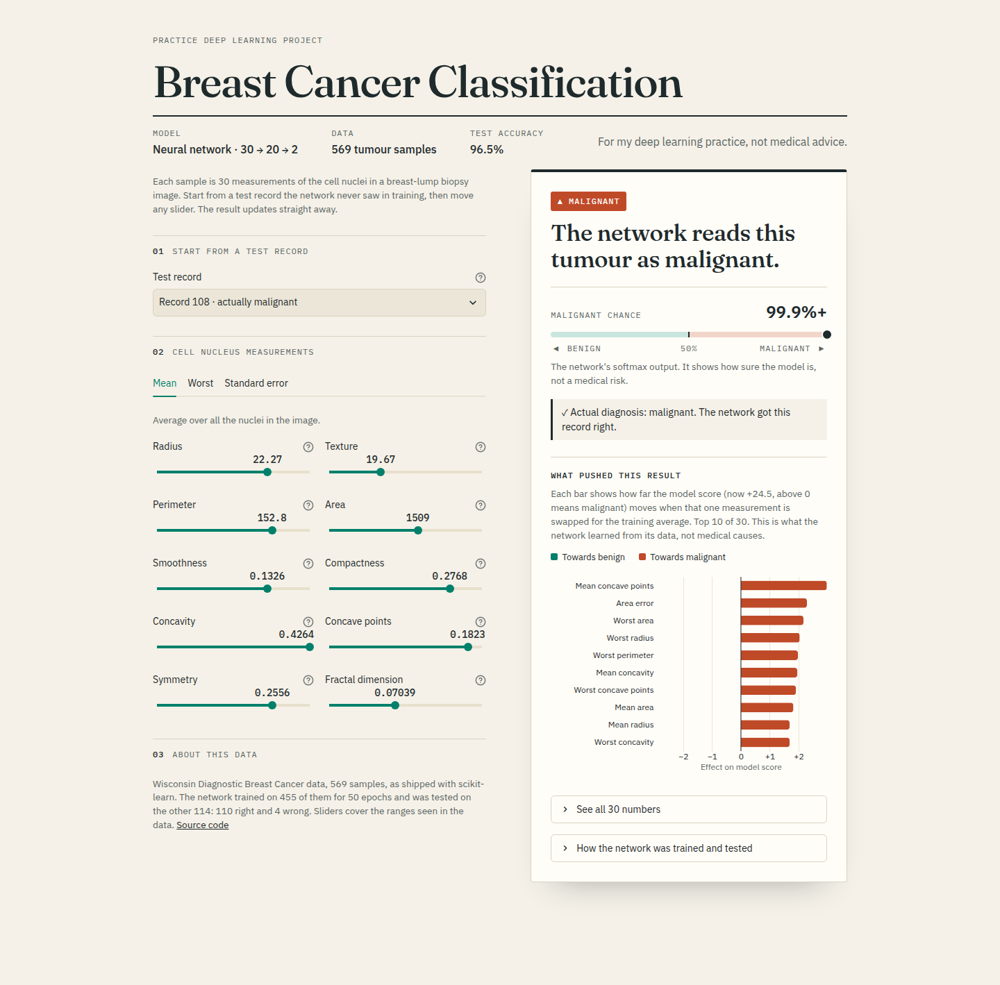

# Breast Cancer Classification with a Neural Network

A small neural network that reads 30 measurements of cell nuclei from a breast-lump biopsy image and predicts whether the tumour is malignant or benign. The Streamlit app lets you pick a test record the network never saw during training, move any measurement, and see the prediction change.

**Live app:** _add the Streamlit link here after deploying_



## Results

Tested on 114 records held back from training:

| | Predicted malignant | Predicted benign |
|---|---|---|
| **Actually malignant (45)** | 43 | 2 |
| **Actually benign (69)** | 2 | 67 |

Test accuracy: **96.5%**.

## Model

- Data: Wisconsin Diagnostic Breast Cancer dataset (569 samples, 30 features), loaded from scikit-learn
- Split: 80% train, 20% test (`random_state=2`)
- Scaling: `StandardScaler`, fitted on the training data only
- Network (TensorFlow / Keras): 30 inputs → Dense(20, ReLU) → Dense(2, softmax)
- Training: Adam, sparse categorical cross-entropy, 50 epochs, 10% of the training data used for validation

The app also shows which measurements pushed each prediction. For every measurement it swaps in the training average and reports how far the model's score (the output before softmax) moves.

## Files

| File | What it is |
|---|---|
| `classification.ipynb` | The notebook where I built and explored the model |
| `train.py` | Trains the same network and saves `model.keras`, `scaler.pkl` and `report.json` |
| `app.py`, `style.css` | The Streamlit app |
| `requirements.txt` | Pinned package versions for the app |

## Run it locally

Use Python 3.12 (TensorFlow 2.21 does not support 3.14 yet).

```bash
python3.12 -m venv dl-venv
source dl-venv/bin/activate
pip install -r Breast-Cancer-Classification-using-NN/requirements.txt

python Breast-Cancer-Classification-using-NN/train.py      # optional, the trained files are already here
streamlit run Breast-Cancer-Classification-using-NN/app.py
```

Run the commands from the repository root so Streamlit picks up the theme in `.streamlit/config.toml`.

This is a learning project, not a medical tool.
